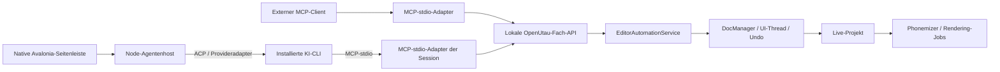

# Vollständiger Umsetzungsplan: OpenUtau MCP und native KI-Seitenleiste

Stand: 14. Oktober 2026. Übergabedokument für eine implementierende KI. Die beschriebenen neuen Komponenten sind **zu implementieren**; ihre Existenz wird nicht behauptet. Dieser Plan basiert auf dem lokalen OpenUtau-Code und einer Untersuchung deiner Projekte All your Companions und CLI-to-API-endpoint.

## 1. Verbindlicher Auftrag und fertiges Ergebnis

Implementiere eine KI-Erweiterung direkt in OpenUtau mit zwei unabhängig nutzbaren Zugängen:

1. **Regulärer MCP-Server:** Codex und andere lokale MCP-fähige KI-Clients können OpenUtau-Werkzeuge normal entdecken und aufrufen. Dafür ist weder die integrierte KI-Seitenleiste noch eine angemeldete KI-CLI erforderlich.
2. **Native zusätzliche Seitenleiste:** Direkt im OpenUtau-Hauptfenster läuft ein angepasster Avalonia-Assistent. Er verbindet installierte KI-CLIs über ACP beziehungsweise passende Provideradapter, ähnlich dem Backend-Konzept von All your Companions. Seine Werkzeugaufrufe benutzen dieselbe MCP-/Editor-Schnittstelle wie externe Clients.

Die KI soll Projekte lesen, Noten und Lyrics erstellen, Aussprache und Phoneme korrigieren, Timing und Ausdruck bearbeiten, mehrteilige Vocal-Songs aufbauen, Vorschauen rendern sowie Projekte und Audio ausgeben können. Alle Live-Änderungen müssen im Editor sichtbar und ordentlich rückgängig machbar sein.

**Die native Seitenleiste ist Teil des vollständigen Ergebnisses.** Sie darf nicht durch ein separates Terminalfenster, eine Web-App oder einen Verweis auf einen externen Chat ersetzt werden. Externe KI-Clients bleiben trotzdem vollwertig nutzbar.

Dieser Auftrag betrifft zunächst einen Vocal-Editor. Automatische Instrumentalproduktion, Quellentrennung und perfekte Transkription beliebiger fertiger Songs sind keine Voraussetzung. Eine bestehende Melodie kann über MIDI übernommen oder als Notenfolge erstellt werden.

## 2. Arbeitsverzeichnisse und Vorgehen der implementierenden KI

| Zweck | Lokaler Pfad |
|---|---|
| Zielprojekt | `C:\Users\zfzfg\Documents\OpenOtau-mcp` |
| Bereits erstellte Architekturübersicht | `C:\Users\zfzfg\Documents\OpenOtau-mcp\OPENUTAU_KI_ARCHITEKTUR.md` |
| Referenz: All your Companions | `C:\Users\zfzfg\Documents\HammerMegaProjekte\GitHub-fetches\grok-build-vscode` |
| Referenz: CLI-Gateway | `C:\Users\zfzfg\Documents\HammerMegaProjekte\GitHub-fetches\CLI-to-API-endpoint` |

Arbeite im Zielprojekt. Die Referenzprojekte werden nur gelesen. Keine Rücksetzungen, Builds, Installationen oder Änderungen dort, um eine OpenUtau-Implementierung vorzubereiten. Insbesondere keine lokale Referenzänderung verlieren.

Vor Implementierung:

- Repository-/Arbeitszustand und anwendbare `AGENTS.md` prüfen; bestehende Änderungen erhalten. In der untersuchten OpenUtau-Kopie war kein `.git` vorhanden. Git-Aufgaben daher nicht blind voraussetzen.
- Zielcode und Referenzcode erneut auf Unterschiede prüfen. Alle hier genannten neuen Dateinamen sind Vorschläge; vorhandene Symbole sind ausdrücklich benannt.
- `AGENTS.md` des Companion-Referenzprojekts verweist auf `CLAUDE.md`; für das Verständnis dort lesen. Dessen Release-/Resetregeln sind kein Auftrag, den Referenzcheckout für diese Leseaufgabe zu verändern.
- Abhängigkeiten und CLI-Versionen ermitteln, gewählte SDK-/Adapterversionen fixieren und mit Lockfiles dokumentieren. Keine Modell-ID, CLI-Fähigkeit oder Paketversion aus diesem Plan ungeprüft als aktuelle Wahrheit verwenden.
- Aus dem Plan eine Fortschrittsliste führen. Jede Phase liefert Code, relevante Tests und Dokumentation. Ein funktionierender Prototyp beendet den Gesamtauftrag nicht.

Es ist keine kostenpflichtige Provider-API als notwendiger Ausweichweg vorgesehen. Die integrierte Anbindung nutzt die vorhandene CLI-Anmeldung. Reale Providerprüfungen werden separat von normalen Tests ausgeführt und verwenden ein verfügbares, zur Prüfung freigegebenes Konto.

## 3. Architekturentscheidungen

| Entscheidung | Vorgabe |
|---|---|
| Besitzer des Live-Projekts | Ausschließlich der OpenUtau-Prozess |
| Fachliche Bearbeitung | Gemeinsamer `EditorAutomationService` mit typisierten DTOs und Commands |
| Verbindung zum laufenden Editor | Kleine lokale HTTP-Fach-API, Loopback, Sitzungsauthentifizierung |
| Externe KI-Werkzeuge | Eigenständiger MCP-stdio-Server als schlanker Adapter zur Fach-API |
| Integrierter KI-Host | Hintergrundprozess in Node/TypeScript; Provideradapter und ACP, unabhängig von der View |
| Oberfläche | Native Avalonia-Controls; MVVM, bestehende Themes und Übersetzungen |
| Interner Chat-Transport | Versioniertes JSON-RPC über Pipes zwischen C# und Agentenhost |
| Gemeinsame Datenverträge | JSON-Schemas als Quelle; generierte C#-/TS-Typen und Vertragsprüfungen |
| Projektänderungen | UI-Thread, definierte Transaktionen, Undo, Konfliktprüfung |
| Lange Verarbeitung | Job-Manager; kein blockierender langer MCP-Aufruf als einziges Verfahren |
| MCP-Clientkonfiguration | Benutzer erhält fertige Konfiguration; globale KI-Einstellungen nicht ungefragt verändern |

Der lokale HTTP-Dienst ist eine Fach-API. Er muss kein MCP-HTTP-Server sein. Die standardisierte öffentliche KI-Schnittstelle ist zunächst MCP über stdio. Ein späterer Streamable-HTTP-MCP-Adapter ist möglich, aber nicht nötig, um den hier geforderten lokalen MCP-Zugang vollständig zu liefern.



Extern gestartete MCP-Adapter und intern gestartete Session-Adapter dürfen mehrere Instanzen haben. Schreibaufträge werden im Editor serialisiert. Kein Adapter darf eine zweite unabhängige `.ustx`-Version als eigentliches Live-Projekt bearbeiten.

## 4. Verifizierte Einbaupunkte und bekannte Fallen

| Bereich | Vorhandene Dateien/Symbole | Umsetzungsfolgen |
|---|---|---|
| Desktop und Layout | `OpenUtau/Views/MainWindow.axaml`, `MainGrid`, `Carousel`, `PianoRollContainer` | Seitenleiste auf äußerer Layoutebene ergänzen; bestehendes Piano-Roll-Layout erhalten |
| Fokus und Shortcuts | `MainWindow.axaml.cs`: `OnKeyDown`, `EditorHotkey`, `OnPointerPressed`, `OnCarouselPageKeyDown` | Chatfokus ausdrücklich vom Editor-Shortcutrouting ausnehmen |
| MVVM | `OpenUtau/ViewModels/MainWindowViewModel.cs` | Reaktive Sichtbarkeit/Breite und eigenes Assistant-ViewModel |
| Start/Ende | `SplashWindow.Start`, `MainWindow.InitProject`, `WindowClosing` | Host nach Initialisierung bereitstellen; erst bei akzeptiertem Shutdown entsorgen |
| Commands/Undo | `OpenUtau.Core/DocManager.cs`: `ExecuteCmd`, `StartUndoGroup`, `EndUndoGroup`, `RollBackUndoGroup` | Ganze Transaktion awaited auf UI ausführen; nicht einzelne Aufrufe blind posten |
| Undo-Kollision | `StartUndoGroup` beendet eine bereits offene Gruppe | Bei Benutzeraktion `EDITOR_BUSY` oder kontrolliert warten; Nutzergruppe nicht abschließen |
| Mutation bei Command-Konstruktion | Phonem-Commands benutzen `GetPhonemeOverride` | Dry-run erstellt DTO-Pläne, keine echten mutierenden Commands |
| Fehler während Command-Ausführung | `ExecuteCmd` nimmt den Command vor `Execute` in die Gruppe auf | Teilweise ausgeführte Commands und Rollback ausdrücklich absichern |
| Identitäten | `UPart.Id` hat `[YamlIgnore]`; Klonen kann dieselbe ID erhalten; Noten/Tracks haben keine passenden externen IDs | Eigene Runtime-Identitäten; Reload/Projektwechsel invalidiert alte Referenzen |
| Revisionen | `DocManager.Revision` steigt auch bei `PhonemizedNotification` | Eigene Edit-Revision und Phonemgenerationen; Renderrevision nicht ungeprüft als Editversion verwenden |
| Snapshots | `Pipeline/Snapshots.cs` | Render-Snapshots sind kein vollständiges externes Editor-Datenmodell |
| Import | `Formats.ImportTracks` verändert Projekt und kann `LoadProjectNotification` verwenden | KI-Import separat planen und undoable anwenden, Undo-Historie nicht löschen |
| Export | `PlaybackManager.RenderMixdown`/`RenderToFiles` fangen Fehler und melden UI-Notifications | Typed Jobresultat herstellen; abgeschlossener Task allein beweist keinen erfolgreichen Export |
| Noten-Batches | `AddNoteCommand` Mehrnotenvariante und Partdauer | Unsortierte Listen und `Max(End)` prüfen, keine Dauer nur aus letzter Eingabenote ableiten |
| Auswahl | `NotesSelectionEvent`, `PartsSelectionEvent`, `TrackSelectionEvent`, `PianoRollOpenPartChangedEvent` | Kontextservice an Editorzustand/Eventbus binden |

Diese Fallen müssen als eigene Tests abgedeckt werden. Sie sind keine Behauptung, dass alle vorhandenen Funktionen allgemein defekt sind; es sind Risiken beim neuen Automatisierungszugang.

## 5. Geplante Modul- und Dateistruktur

```text
OpenUtau.Core/Automation/
  Contracts/                 # generierte/projektbezogene DTOs
  EditorAutomationService.cs
  AutomationIdentityRegistry.cs
  AutomationRevisionTracker.cs
  AutomationTransactionRunner.cs
  AutomationEditPlanner.cs
  EditorSnapshotService.cs
  PhonemizationCoordinator.cs
  SongImportService.cs
  AutomationDiagnostics.cs
  AutomationJobManager.cs
  AutomationArtifactStore.cs
  AutomationOperationJournal.cs
  AutomationProposalStore.cs

OpenUtau/Automation/
  AutomationHttpHost.cs
  AutomationDiscoveryService.cs
  AutomationAccessService.cs
  AutomationContextService.cs
  AutomationLifecycleService.cs

OpenUtau/Assistant/
  AssistantSessionService.cs
  AssistantProcessClient.cs
  AssistantHistoryStore.cs
  AssistantContextBuilder.cs
  AssistantProviderCatalog.cs

OpenUtau/Controls/
  AssistantSidebar.axaml
  AssistantSidebar.axaml.cs
  AssistantMessageCard.axaml
  AssistantToolCard.axaml
  AssistantEditPreview.axaml

OpenUtau/ViewModels/
  AssistantSidebarViewModel.cs
  AssistantMessageViewModel.cs
  AssistantSettingsViewModel.cs

OpenUtau/Styles/AssistantStyles.axaml

tools/openutau-ai/
  package.json
  package-lock.json
  packages/contracts/
  packages/mcp-server/
  packages/agent-host/
  test/fixtures/fake-acp-agent.*
  scripts/build-package.*

contracts/automation/v1/
  tools.json
  edit.schema.json
  results.schema.json
  agent-host.schema.json

OpenUtau.Test/Core/Automation/
OpenUtau.UiTest/AssistantSidebarTest.cs
docs/ai/                    # Installation, Protokolle, Provider, Grenzen
```

Abhängigkeiten bleiben gerichtete Schichten: Core-Fachlogik kennt weder Node noch HTTP noch Avalonia-Chatcontrols. Die Desktop-App hostet HTTP und UI. TS-MCP-Adapter kennt Fachverträge und Discovery; Agentenhost kennt ACP/Provider und Chatverträge.

Für den HTTP-Host Kestrel und kontrollierte .NET-Hosting-Abhängigkeiten verwenden. Vor Festlegung prüfen, wie `Microsoft.AspNetCore.App` beziehungsweise ein separater Host-Library-Verweis in die existierenden Self-contained-Pakete eingeht. Keine ungetestete Framework-Abhängigkeit in ein fertiges Portable-Paket einschleusen. Die aktuellen .NET-10-/Windows-TargetFramework-Bedingungen der App und Core-Projekte erhalten.

Alle neuen Komponenten besitzen `DisposeAsync`/klaren Ownership-Vertrag, testbare Abstraktionen für Dispatcher, Uhr, Dateizugriff, Providerprozess und Renderer. Singleton-Zugriffe nur an den bestehenden Integrationsgrenzen, nicht in jeder Fachfunktion.

## 6. Lokale Fach-API, Discovery und Verbindung

### 6.1 Dienst und Endpunkte

Bindung an `127.0.0.1` mit vom Betriebssystem zugewiesenem Port. Keine LAN-Freigabe. Der Dienst startet nach Dokument-/UI-Initialisierung, wenn Automatisierung aktiv ist. Der native Assistent kann diesen Modus beim ersten Verbindungsaufbau aktivieren. Externer MCP-Betrieb muss anschließend auch bei geschlossener Seitenleiste möglich sein.

Vorgeschlagene Endpunkte:

- `GET /automation/v1/health`: Dienst-/Protokollbereitschaft, keine Projektinhalte ohne Authentifizierung.
- `POST /automation/v1/invoke`: Fachfunktion mit korreliertem Request/Result.
- `GET /automation/v1/operations/{operationId}`: Ergebnis eines möglicherweise bereits übernommenen Auftrags.
- `GET /automation/v1/jobs/{jobId}` und `POST .../cancel`: Jobzustand und Abbruch.
- `GET /automation/v1/events`: optionaler eigener Ereignisstream für Job-/Projektstatus. Dieser ist internes Fachprotokoll, kein eigengebauter MCP-Transport.

Request enthält `apiVersion`, `requestId`, `clientId`, `operation`, `arguments`. Schreibzugriffe tragen zusätzlich `projectSessionId`, `expectedEditRevision`, `operationId`. Jeder Aufruf wird mit der authentifizierten Identität verbunden; die im JSON angegebene Identität ersetzt keine Authentifizierung.

### 6.2 Discovery

- Runtime-Ordner pro Benutzer außerhalb des Projektverzeichnisses; über zentralen Pfadservice definieren. Bei portablen Installationen Runtime-Daten trotzdem nicht in öffentlich lesbare Paketordner schreiben.
- Pro Editorprozess Descriptor mit `instanceId`, `pid`, Startzeit, `apiVersion`, Port/URL, Appversion und Credential-Referenz. Atomar schreiben und nur für den Benutzer lesbar halten; Windows-ACL beziehungsweise POSIX-Modus prüfen.
- Sitzungstoken mit kryptografischem Zufall; nicht in Konsolenlogs, Songdateien oder kopierter Clientkonfiguration ausgeben. Token separat geschützt oder im entsprechend geschützten Descriptor ablegen; Struktur und Berechtigungen dokumentieren.
- MCP-Adapter erkennt tote Descriptoren über Health/Startidentität, nicht nur über PID. Nur eigene Staledaten bereinigen.
- Mehrere verfügbare Instanzen → `openutau_list_instances` und explizite `instanceId`. Bei Mehrdeutigkeit nie die zuletzt gestartete Instanz erraten.
- Keine laufende App → stabiles `APP_NOT_RUNNING`; keine automatische Installation/CLI-Anmeldung und kein heimlicher Desktopstart.
- Neustart invalidiert Credentials und `projectSessionId`. Der Adapter kann erneut entdecken, darf aber alte Schreibaufträge nicht auf ein neues Projekt umleiten.

### 6.3 Grenzen

Tokenprüfung, Requestgrößenlimits, Schema-Validierung, Timeout und `Origin`-Prüfung für Browseranfragen. Standardmäßig 2 MiB JSON pro Request; große Songs in begrenzten Batches. Kein beliebiger Shell-/C#-/Dateisystem-Ausführungsendpunkt. Projekt-/Dateiinhalte sind Daten, keine Autorisierung.

`AutomationAccessService` stellt autoritative, widerrufbare Grants aus. Native Sessiongrant enthält `grantId`, Projektsession, erlaubte Tool-/Operationgruppen, musikalischen Bereich, Modus (`read_only`, `preview`, `apply`), Prozessgeneration und Ablauf. Request authentifiziert dieses Grant über ein eigenes Credential; `clientId` und Umgebungsvariable allein gewähren keine Rechte. Native UI kann Grants erstellen/ändern/widerrufen; der Agent kann über diesen Protokollweg seinen Umfang nicht selbst erweitern. Moduswechsel prüft/invalidiert ausstehende Vorschläge, Projektwechsel invalidiert alte Projektgrants, Sessiondispose/Prozesswechsel widerruft deren Credentials. Dies ist eine Autorisierungsgrenze der Editor-API, kein Ersatz für das Sandboxmodell der CLI.

Für reguläre externe MCP-Clients wird über die geschützte lokale Discovery eine externe Verbindung gemäß den in OpenUtau eingestellten Rechten aufgebaut. Der Dienst mintet daraus einen eigenen Connectiongrant; Sidebar ist dafür nicht nötig. Standard externer Zugriff darf konfigurierte normale Bearbeitung ermöglichen, statt bei jedem Tool eine Pflichtbestätigung einzuführen. Read-only-/Bereichsbegrenzungen gelten serverseitig auch extern. Eine neue Projektsession muss explizit neu gebunden werden; veraltete Writes wandern nie automatisch mit.

Ein Sessiontoken schützt nicht vor jedem Prozess mit denselben Benutzerrechten. Im Produkt keine stärkere Isolation behaupten. Native CLI-Datei-/Shellrechte sind zusätzlich providerabhängig und müssen separat sichtbar bleiben.

### 6.4 Dateizugriff und nutzbare Handles

Der Editor verwaltet erlaubte Arbeitsbereich-/Exportwurzeln. Standardmäßig das Verzeichnis des geöffneten Projekts, bei ungespeicherten Projekten einen eigenen App-Arbeitsbereich. Nutzer kann zusätzliche Ordner in Einstellungen oder über einen nativen Dateidialog freigeben. Die Freigabe ist ein Dateizugriffsvertrag, kein zweiter Musikbearbeitungsweg.

`openutau_register_input_file` nimmt absoluten Pfad und Zweck (`project`, `midi`, `audio`) an. Innerhalb einer bereits freigegebenen Wurzel liefert es nach Typ-/Existenz-/Größenprüfung ein zeitlich begrenztes, sessiongebundenes `fileHandle` plus Metadaten. Links/Reparsepoints kanonisch auflösen; die aufgelöste Datei muss in der freigegebenen Wurzel bleiben. Vor tatsächlichem Import Änderungen anhand Dateifingerprint erkennen.

`openutau_resolve_output_target` nimmt absoluten Zielpfad, Ausgabetyp und `overwrite` entgegen. Es liefert nach Elternpfad-/Wurzel-/Existenzprüfung ein `outputHandle`. Bei existierender Datei muss `overwrite: true` ausdrücklich angegeben sein; Apply/Save prüft Zielzustand erneut. Handles aus anderer Session oder abgelaufene Handles ablehnen.

Import/Open verwenden `fileHandle`; Save/Export verwenden `outputHandle`. Ein externer Standardclient erhält diese Handles über die beiden regulären Werkzeuge, ohne Zugriff auf eine interne Sidebarfunktion. Pfad außerhalb erlaubter Wurzeln → `FILE_ACCESS_DENIED` mit verständlichem Hinweis zur Ordnerfreigabe; kein versteckter dauerhaft offener Bestätigungsdialog. Native Dateiaktionen können dieselbe Freigabelogik mit einer vom Nutzer ausgewählten Datei bedienen.

## 7. Fachliche Identitäten, Revisionen und Zustandsmodell

### 7.1 Runtime-Identitäten

`projectSessionId` ist eine zufällige ID pro geladenem Projektzustand. Beim Öffnen, Neuladen und Ersetzen eines Projekts neu erzeugen. Runtime-Registry vergibt `trackId`, `partId`, `noteId` für Objektidentitäten. IDs bleiben über Verschieben, Undo und Redo innerhalb dieser Projektsession stabil; Duplikate erhalten neue IDs.

`UPart.Id` nicht als dauerhaft gespeicherte ID versprechen. Für V1 keine neue Pflichtmetadaten-Struktur im `.ustx`-Format. Nach Reload erneut lesen. Kopien und strukturelle Replace-Operationen brauchen definierte ID-Regeln und Tests. Kein Hashcode, Name, Tonhöhe, Tickposition oder veränderlicher Listenindex als externe Identität.

### 7.2 Revisionen

- `editRevision`: erhöht sich bei fachlich relevanten Nutzer-/KI-Änderungen einschließlich Undo/Redo, Singer-/Phonemizer-/Tempo-/Ausdrucksänderungen.
- Phonemstatus pro Part enthält `requestedGeneration`, `completedGeneration` und `sourceEditRevision`. Nach relevanter Lyric-/Singer-/Phonemizeränderung ist der alte fertige Stand sofort stale, auch bevor ein neues Ergebnis eintrifft. `phonemeGeneration` bezeichnet den ausdrücklich aktuellen fertigen Ergebnisstand.
- Bestehende `DocManager.Revision` bleibt für bestehende Pipelines erhalten; zusätzliche Semantik nicht heimlich hineinlegen.
- Command-/Undo-Gruppen-Commit und Projektwechsel als eindeutige Ereignisse bereitstellen. Der Tracker muss auch Nicht-KI-Änderungen und relevante transiente Änderungen sehen.
- Phonem-Overrides verlangen zusätzlich die Generation, auf die sich ihr Index bezieht. Nur `noteId + phonemeIndex` genügt nach einer neuen Phonemisierung nicht.
- Override nur akzeptieren, wenn angegebene Generation und deren Ursprungsstand aktuell sind und keine neuere relevante Phonemisierung aussteht. `get_phonemes` liefert alte Daten höchstens ausdrücklich als stale, niemals als aktuelle Schreibgrundlage.
- Read-DTOs enthalten `projectSessionId`, `editRevision`, Bereitschaft der Phonemisierung sowie Einheitendefinitionen.

Paginiertes Lesen bindet den Cursor an `instanceId`, `projectSessionId`, einen unveränderlichen `snapshotId` und den Filter. Folgeseiten stammen ausschließlich aus diesem Snapshot. Snapshot-TTL und Speicherlimit explizit in Capabilities melden; bei Ablauf `SNAPSHOT_EXPIRED` und erneut lesen. Projektwechsel invalidiert die alten Cursors. Eine laufende Editänderung darf keine Seiten aus verschiedenen Revisionsständen mischen. Write aus älterem Snapshot bleibt über `expectedEditRevision` geschützt.

### 7.3 Zeit und musikalische Daten

Notenpositionen explizit relativ zum Part; Partpositionen relativ zum Projekt. Alle Zeitfelder nennen ihre Einheit: `positionTicks`, `durationTicks`, `offsetTicks`, `preutterDeltaMs`. Tickauflösung aus dem Projekt auslesen, keine fest angenommene PPQ. Tempo-/Taktkarten, MIDI-Tonhöhen und gegebenenfalls Tuning-Cents sauber modellieren. Melismen/Extender als Lyrics-Konzept abbilden; keine pauschale Silbe-pro-Note-Regel.

## 8. Transaktionen, Dry-run, Undo und gleichzeitige Bearbeitung

Schreibablauf:

1. Schema und Limits prüfen; wiederholte `operationId` erkennen.
2. Auf UI-Thread aktuelle Projektsession, Zielobjekte, Editrevision, relevante Phonemgeneration und offene Undo-Gruppe prüfen.
3. Aus DTOs einen inert vorbereiteten Änderungsplan erstellen. Dry-run und Vorschau verändern weder Projekt noch History noch Overrides.
4. Änderungen vorprüfen: Zielbereiche, Notenlängen, Überläufe, gültige Referenzen, Singer-/Rendererfähigkeiten und Ausdrucksgrenzen.
5. Eine komplette Transaktion awaited auf dem UI-Thread ausführen. Echte Commands erst dort erstellen; deren Konstruktoren können bereits mutieren.
6. Commit/Validierung/Invalidierung/Undo abschließen; operation journal aktualisieren. Erst danach `committed` zurückgeben.
7. Phonemisierung und Rendering laufen getrennt; bei Bedarf eine zugehörige Job-/Generationsreferenz zurückgeben.

Die vorhandene UI-Weiterleitung von `ExecuteCmd` ist kein awaitbarer Transaktionsabschluss. Ein Dispatcher-Wrapper muss Exceptions/Ergebnis über `TaskCompletionSource` oder ein gleichwertiges Verfahren zurückreichen. Keine `Wait()`/`Result`-Blockierung der Avalonia-UI.

**Rollback muss tatsächlich implementiert und getestet werden.** `RollBackUndoGroup` lässt die Gruppe bestehen; anschließend korrekt abschließen. Teilmutationen durch Command-Konstruktoren und Exceptions während `Execute` benötigen Vorzustand oder explizit exception-sichere Commands. Eine bloße `try/finally EndUndoGroup()`-Lösung darf fehlerhafte Änderungen nicht als erfolgreichen Commit speichern. Wenn ein bestehender Command keine sichere Anwendung erlaubt, dessen Semantik absichern oder einen passenden neuen Command ergänzen.

Bei aktiver Benutzer-Undo-Gruppe `EDITOR_BUSY`; Retry nach neuer Abfrage oder begrenzt auf Bereitschaft warten. Nicht die Nutzergruppe schließen. Bei veralteter Revision `REVISION_CONFLICT` mit aktuellem Zustandshinweis; kein stilles Merge nach Listenindex. Schreibaufträge mehrerer Clients serialisieren; UI und Lesen bleiben benutzbar.

Ein Undo-Schritt pro logisch begrenztem Batch. Ein mehrteiliger Song kann mehrere Schritte haben; `runId` ordnet sie einem Vorgang zu. Kein stundenlang offener Undo-Block. `revert_operation` darf nur eine kompatible jüngste Änderung zurücknehmen; bei zwischenzeitlichen Nutzeränderungen Konflikt melden, nicht pauschal deren Arbeit mit rückgängig machen.

Journalstatus: `queued`, `validating`, `committed`, `failed`, `cancelled_before_commit`. Nach Verbindungsabbruch den Status prüfen statt blind erneut schreiben. Gleiche ID mit anderem Payload → `IDEMPOTENCY_CONFLICT`. Nach App-Neustart Operationen nicht automatisch wiederholen.

Für `preview`-Grants wird zusätzlich ein konkreter Vorschlagsablauf implementiert: Der Dienst speichert eine unveränderliche Vorlage mit `proposalId`, Payloadhash, Basisrevision, Zielbereich, Grant und Ablauf. `apply_edit_batch` liefert in diesem Modus `awaiting_approval` und die Vorschlagsreferenz; ein Commit ist noch nicht erfolgt. Native Reviewkarte zeigt genau diesen Vorschlag. „Übernehmen“ ruft die appseitige Approvalfunktion auf, prüft Grant/Hash/Revision erneut und führt einmalig aus. Der Agent erhält kein Tool, das seine eigene erforderliche Freigabe erteilen kann.

„Ablehnen“/Stop vor Commit setzt `rejected` beziehungsweise `cancelled_before_commit` und nimmt die Karte zurück. Veraltete Freigabe → Konflikt, neuer Vorschlag nötig. Journal und `get_operation` kennen `awaiting_approval`/`rejected` zusätzlich. Externe Clients benutzen standardmäßig ihre konfigurierten `apply`-/`read_only`-Grants und brauchen keine native Reviewkarte. `preview_edit` bleibt unabhängig vom Modus eine rein lesende Vorschau. Ein ausdrücklich extern gewählter Preview-only-Grant liefert diese Vorschau und akzeptiert keinen Commit, bis der Nutzer den Verbindungsmodus in OpenUtau ändert; nicht still auf eine unsichtbare Sidebarantwort warten.

## 9. Regulärer MCP-Server: Werkzeuge und Rückgaben

### 9.1 Kompatibilitätsvertrag

Eigenständiger Startbefehl `openutau-mcp --stdio` beziehungsweise gebündeltes Node-Entry. Der Server implementiert reguläres MCP über ein offizielles SDK: Initialisierung, `tools/list`, `tools/call`, feste Toolnamen, präzise Beschreibungen und JSON-Schemas. Auf stdout ausschließlich Protokollnachrichten; Diagnose auf stderr. Die Toolliste bleibt auch ohne offene App abrufbar.

Kein Spezialprompt, keine eingebaute Sidebar und kein Companion-spezifischer Callback nötig, um ein Werkzeug aufzurufen. Die Sidebar erhält denselben Server über `mcpServers` ihrer Agentensession. Sie führt musikalische Änderungen nicht über einen parallelen versteckten Pfad aus.

Strukturierte Ergebnisse zusätzlich als kompatiblen Textinhalt zurückgeben; Fehler auf Tool-Ebene mit `isError` und fachlichem Code kennzeichnen, Protokollfehler von fachlichen Fehlern unterscheiden. Annotations für Lesen, destruktive Aktionen und Idempotenz passend setzen; sie ersetzen keine Servervalidierung. [Offizielle MCP-Werkzeugspezifikation](https://modelcontextprotocol.io/specification/2025-11-25/server/tools).

### 9.2 Verpflichtender Werkzeugkatalog

| Werkzeug | Zweck und zentrale Argumente |
|---|---|
| `openutau_list_instances` | Laufende erreichbare Instanzen, Versionen und Bereitschaft |
| `openutau_get_project` | `instanceId`; Tracks, Parts, Tempo-/Taktkarte, Auflösung, Session/Revision; Noten nur paginiert |
| `openutau_get_selection` | Aktuelle Spur/Part/Notenauswahl über Kontextservice, auch bei detached Piano Roll |
| `openutau_get_capabilities` | Protokoll-, Renderer-, Ausdrucks- und Werkzeugfähigkeiten, Limits |
| `openutau_list_singers` | Installierte verwendbare Sänger; Such-/Pagingargumente; keine beliebigen Dateizugriffe |
| `openutau_list_phonemizers` | Verfügbare Phonemizer und bekannte Fähigkeiten; unbekannte Fähigkeiten ausdrücklich markieren |
| `openutau_get_notes` | `partId`, optionaler Tickbereich, Cursor/Limit; Lyrics/Pitch/Vibrato/Overrides nach Bedarf |
| `openutau_get_phonemes` | `partId`/Notenfilter; Aliase, Mapping, Timing, Fehler, Generation und Readyzustand |
| `openutau_get_diagnostics` | Projekt/Partbereich; fehlende Samples, ungültige Dauer, Renderer-/Phonemizerprobleme |
| `openutau_preview_edit` | Gleiches Edit-DTO wie Apply; validieren und musikalischen Diff ohne Mutation erzeugen |
| `openutau_apply_edit_batch` | Erwartete Session/Revision, `operationId`, Liste definierter Fachoperationen |
| `openutau_register_input_file` | Absoluter Pfad innerhalb freigegebener Wurzel, Zweck/Typ; liefert Import-/Openhandle |
| `openutau_resolve_output_target` | Validiertes Ausgabeziel und explizite Überschreiboption; liefert Save-/Exporthandle |
| `openutau_new_project`, `openutau_open_project` | Gesonderter Projektlebenszyklus, Save/Cancel-Konflikt und neue Session-ID |
| `openutau_import_midi` | Validierter Dateihandle, Mapping/Tempooptionen; Vorschau und undoable Import |
| `openutau_import_audio` | Freigegebene Audiodatei als Wave-Part/Instrumental, undoable und mit Längen-/Formatprüfung |
| `openutau_wait_for_phonemes` | Erwarteter Part-/Editstand, begrenzte Wartezeit; ready/pending/stale statt endlos warten |
| `openutau_start_render` | Bereich/Spuren/Part, Snapshotrevision, preview/stems/mixdown; sofortige Job-ID |
| `openutau_get_job` | Jobstatus, Fortschritt, Fehler und Artefakte |
| `openutau_cancel_job` | Idempotenter Abbruch; unterscheidet Abbruchwunsch und bestätigten Abbruch |
| `openutau_get_operation` | Commit-/Fehlerzustand nach Timeout oder Verbindungsabbruch |
| `openutau_revert_operation` | Guarded Rücknahme kompatibler eigener letzter Transaktion |
| `openutau_play_range`, `openutau_stop_playback` | Preview-/Projektwiedergabe eines expliziten Bereichs, kein Musikdaten-Write |
| `openutau_save_project` | Session/Revision, freigegebenes Ziel, explizite Überschreiboption |
| `openutau_export_audio` | Exportjob für Preview/Stems/Mixdown, validiertes Ziel |

Keine generischen `eval`, Shell-, unbeschränkten `write_file`- oder „beliebige Projektfelder setzen“-Tools. Fehlende Funktionen durch explizite Fachoperationen ergänzen.

### 9.3 Unterstützte Editoperationen

V1 muss `set_project_info`, `set_tempo_map`, `set_time_signature_map`, `add_track`, `update_track`, `remove_track`, `add_part`, `update_part`, `remove_part`, `add_notes`, `update_notes`, `remove_notes`, `set_lyrics`, `set_phonetic_hints`, `set_phoneme_overrides`, `clear_phoneme_overrides`, `set_pitch`, `set_vibrato` und `set_expressions` abbilden. Projektneuanlage/-wechsel läuft über die gesonderten Lifecycletools.

Projektneuanlage/-wechsel ist ein gesonderter Lebenszyklusvorgang mit Sessionwechsel und bestehender Save/Cancel-Behandlung, keine normale Suboperation mitten im Batch. Destruktive Track-/Partentfernung ist explizit. Ein Songentwurf erzeugt Tracks/Parts und füllt sie; bestehende Projekte werden nicht automatisch komplett ersetzt.

Frisch erzeugte Tracks/Parts/Noten können innerhalb eines Batches über eindeutige `clientRef`-Werte referenziert werden; das Ergebnis liefert deren Mapping auf Runtime-IDs. Änderungen geben tatsächlich angewandte Werte zurück, einschließlich eventueller kontrollierter Clamp-Ergebnisse. `SortedSet<UNote>` über Move-/Resize-Commands bearbeiten; Positionsfelder nicht direkt verändern.

Bei `set_phonetic_hints` phonetischen Hinweis und sichtbaren Lyrictext im DTO trennen; danach korrekt in das vom konkreten Phonemizer unterstützte Format umsetzen. Universelles IPA/Arpabet-Verständnis nicht vortäuschen. Klassische Aliase gegen Oto/Mapping prüfen, andere Renderer über ihre eigenen Fähigkeiten.

Pitch/Vibrato/Expressions über bestehende Command-/Kurvensysteme, inklusive Maßeinheiten und zulässiger Werte. Rendererabhängige Ausdrücke nur nach Capability-Abfrage anbieten.

### 9.4 Beispiel für einen normalen MCP-Schreibauftrag

```json
{
  "instanceId": "ou_instance_01",
  "projectSessionId": "ou_project_session_01",
  "expectedEditRevision": 42,
  "operationId": "8ade2a6d-1d8e-4ba9-a86b-a44f5c28709c",
  "label": "Lyrics für die erste Phrase",
  "operations": [
    {
      "type": "set_lyrics",
      "partId": "part_01",
      "items": [
        { "noteId": "note_01", "lyric": "hello" },
        { "noteId": "note_02", "lyric": "+" }
      ]
    }
  ]
}
```

```json
{
  "ok": true,
  "operationId": "8ade2a6d-1d8e-4ba9-a86b-a44f5c28709c",
  "status": "committed",
  "projectSessionId": "ou_project_session_01",
  "editRevision": 43,
  "changed": { "notes": 2, "parts": 1 },
  "undo": { "available": true, "label": "Lyrics für die erste Phrase" },
  "derived": { "phonemes": "pending", "partIds": ["part_01"] }
}
```

IDs und Revisionszahlen sind nur Beispiele. Ein erfolgreicher Edit sagt hier ausdrücklich noch nicht, dass die Aussprache oder das Audio fertig ist.

### 9.5 Fehlerkatalog

`APP_NOT_RUNNING`, `APP_UNAVAILABLE`, `AUTOMATION_DISABLED`, `APP_INITIALIZING`, `INSTANCE_AMBIGUOUS`, `UNAUTHORIZED`, `PROTOCOL_MISMATCH`, `PROJECT_CHANGED`, `SNAPSHOT_EXPIRED`, `ENTITY_NOT_FOUND`, `REVISION_CONFLICT`, `PHONEME_GENERATION_CONFLICT`, `EDITOR_BUSY`, `INVALID_ARGUMENT`, `LIMIT_EXCEEDED`, `UNSUPPORTED_CAPABILITY`, `MISSING_SINGER`, `MISSING_ALIAS`, `PHONEMIZER_FAILED`, `RENDER_FAILED`, `FILE_ACCESS_DENIED`, `IDEMPOTENCY_CONFLICT`, `CANCELLED`, `OPERATION_STATE_UNKNOWN`.

Ergebnisse enthalten verständliche Meldung, betroffene IDs und handlungsfähige Hinweise. Ein Timeout nach möglichem Commit darf nicht pauschal als „nichts geändert“ gemeldet werden. Stacktraces und lokale Zugangsdaten nicht in normale Tooltexte aufnehmen.

## 10. Songaufbau, Phonemisierung und Rendering

### 10.1 Vollständiger Vocal-Song

Der Assistent muss größere Projekte über mehrere begrenzte Batches erzeugen können: Songstruktur und Tempo → Stimme/Phonemizer → Tracks/Parts → Noten → Lyrics/Melismen → Phoneme → Tuning/Ausdruck → Abschnittsvorschau → Korrektur → Export.

Eine `runId` verbindet den Ablauf, ohne jeden Schritt zu einem undurchsichtigen Mega-Tool zu machen. Agent erhält nach jedem Commit neue Revision/IDs. Große Notenfolgen deterministisch übertragen, nicht tausende einzelne Toolaufrufe. Grenzen aus Capability-/Limitdaten beachten; fortsetzbare Abschnittsarbeit unterstützen.

Für Import eine vom Editor verwaltete Datei-/Arbeitsbereichsfreigabe verwenden. MIDI off-thread lesen, Tempo-/Spur-/Partänderungen vorplanen und auf UI über Commands anwenden. Nicht `Formats.ImportTracks` direkt als vermeintlich undoable KI-Funktion benutzen.

### 10.2 Phonemisierung

Lyricänderung startet oder invalidiert abgeleitete Verarbeitung. `wait_for_phonemes` wartet auf genau den angefragten Stand oder liefert `pending`/`stale`; das Eintreffen irgendeiner älteren Response darf nicht als Erfolg gelten. Phonemizer-/Singerwechsel ebenso behandeln.

Overridetools lesen den fertig erzeugten Index-/Generationsstand. Änderungen sind persistente Overrides/Expressions und werden nach Speichern/Öffnen sowie erneuter Phonemisierung geprüft. Direkte Mutation von `UPhoneme`-Listen ist keine Implementierungsstrategie.

### 10.3 Jobs und Audio

Jobzustände: `queued`, `waiting_for_phonemes`, `running`, `cancelling`, `succeeded`, `failed`, `cancelled`. Job bindet `projectSessionId` und den Eingangsstand. Bei Projektwechsel abbrechen oder isoliertes Ergebnis eindeutig kennzeichnen; nicht fremdem Projekt zuordnen.

Vorhandenes Rendering über geeignete snapshot-/render-view-basierte Abläufe wiederverwenden. Wenn sich das Live-Projekt während des Renderns ändert, Ergebnisrevision nennen und stale kennzeichnen. Keine mutable Projektinstanz ungeschützt im Worker weiterbenutzen.

`PlaybackManager` braucht einen typed Ergebnispfad beziehungsweise propagierte Fehler für Automatisierung. Bestehende UI-Notifications erhalten. Erfolg erst nach vollständigem Render/Dateiabschluss und geeigneter Prüfung von Format, Dauer und Existenz melden. Export zunächst in temporäre Datei, danach atomar ins freigegebene Ziel übernehmen.

Artefaktantwort: `artifactId`, Typ, absolute lokale Datei, Format, Dauer, Spuren/Bereich, Projekt-/Editstand. Native Sidebar spielt die Vorschau über kontrollierte Audiowiedergabe ab. Nicht jeder MCP-Client kann Audio hören; Dateiverweis und Metadaten müssen trotzdem brauchbar sein. Keine großen Audiodaten in normale JSON-Ergebnisse einbetten.

Ressourcen für Vorschau-/Exportdateien besitzen Begrenzung und Bereinigung. Nutzerexporte nicht mit temporären Previewdateien löschen. Rendering-Abbruch darf keine unverifizierte fertige WAV zurückgeben.

## 11. CLI-/ACP-Agentenhost nach dem Companion-Muster

### 11.1 Zwei unterschiedliche Executables

- `openutau-agent-host --stdio`: privates Chat-/Sidebar-Protokoll, startet und betreut Agentenprozesse.
- `openutau-mcp --stdio`: öffentlicher regulärer MCP-Server, startet keine KI.

Nicht das private Chatprotokoll als MCP ausgeben. Der C#-Assistent startet den Agentenhost mit umgeleiteten Pipes und verborgenem Fenster. Agentenhost startet die ausgewählte CLI beziehungsweise deren ACP-Adapter. Versionierter Handshake muss App/Host/Vertragsversionen und Fähigkeiten vergleichen.

### 11.2 Providervertrag

Ein kleiner `ProviderBackend` kapselt Binary-/Adapterauflösung, Launchspec, Handshake, Sessions, Modelcatalog, Antworten, Toolereignisse, Fragen/Permissions, Cancellation und optionales Resume/Steering. Gemeinsame Logik nicht mit verstreuten Provider-Strings implementieren.

Modelle und Effortoptionen aus dem realen Session-/Providerkatalog lesen. CLI-Anmeldung bleibt beim Provider. Verbindungsfehler unterscheiden: CLI fehlt, Adapter fehlt, Version nicht unterstützt, nicht angemeldet, Kontingent erschöpft, Protokollfehler.

| Provider | Im Referenzcode beobachteter Stand | Verpflichtung dieses Plans |
|---|---|---|
| Codex | Host-MCP vorhanden; gesonderter Codex-ACP-Adapter | Erster vollständig implementierter und abgenommener Sidebar-Provider |
| Claude | Host-MCP vorhanden; eigener ACP-Adapter | Danach implementieren und separat abnehmen |
| Grok | Host-MCP vorhanden; native ACP-Anbindung | Danach implementieren und separat abnehmen |
| Antigravity/Gemini | Host-MCP-Verbrauch als `probe` geführt | Adapter-/Capability-Platz vorsehen; Musiksteuerung nur nach nachgewiesener Toolrunde freischalten |
| Muse | Referenzadapter nimmt keine Host-MCP-Server an | Nicht als OpenUtau-Steuerprovider ausgeben; erst mit einer neu verifizierten Werkzeuganbindung anbieten |

Vollständiger verpflichtender Erstumfang: Codex, Claude und Grok als Backendimplementierungen mit Fake-Tests; real verfügbare Anbieter müssen die Live-Abnahme bestehen. Ein fehlendes Konto ist eine ausdrücklich dokumentierte Abnahmegrenze, kein stilles „vollständig geprüft“. Die anderen beiden Anbieter sind vorgesehene Erweiterungspunkte, keine behauptete vorhandene Funktionsgleichheit.

### 11.3 MCP-Injection

Beim Session-New **und Resume/Load** die konkrete OpenUtau-MCP-Konfiguration injizieren. Für den vorhandenen ACP-v1-Stdio-Vertrag:

```json
{
  "name": "openutau",
  "command": "ABSOLUTER_PFAD_ZUM_GEBUENDELTEN_NODE",
  "args": ["ABSOLUTER_PFAD_ZU_OPENUTAU_MCP_JS", "--stdio"],
  "env": [
    { "name": "OPENUTAU_INSTANCE_ID", "value": "AKTUELLE_INSTANZ" },
    { "name": "OPENUTAU_CLIENT_ID", "value": "AKTUELLE_ASSISTENTENSESSION" },
    { "name": "OPENUTAU_ACCESS_GRANT_REF", "value": "GESCHUETZTE_REFERENZ_DES_NATIVE_SESSIONGRANTS" }
  ]
}
```

Credentials über geschützten Descriptor/geeignete Child-Umgebung bereitstellen, nie über argv. Native Adapter müssen das explizite Sessiongrant verwenden und dürfen bei abgelaufener Grantreferenz nicht auf allgemeine externe Discoveryrechte zurückfallen. `env: []` mitliefern, wenn kein Eintrag erforderlich ist. Dieser JSON-Ausschnitt ist der Referenz-v1-Vertrag; bei v2 die ausgehandelten Typdiscriminator-/Capabilityregeln verwenden. Nicht ungeprüft beide Varianten mischen.

MCP-Injection ist keine Abschaltung anderer Providerwerkzeuge. Namens-/Konfigurationskollisionen erkennen; keine globalen Providerkonfigurationen überschreiben. Wiederholtes Resume darf den gleichen Server nicht mehrfach injizieren.

### 11.4 Prozess- und Turnlebenszyklus

- Spawn mit Argumentarray, kontrolliertem `cwd`, ohne Shell als normalen Agentenstart. Windows-Wrapper/Adapterdateien kontrolliert auflösen; Pfade mit Leerzeichen und Unicode testen.
- stdout vom Host nur für JSON-RPC; Child-Ausgaben begrenzt parsen und unterscheiden. Keine Zugangsdaten in Fehlern/Logs.
- UTF-8 über Chunkgrenzen korrekt dekodieren; JSONL-Zeilen-/Payloadlimits, invalid frames und EOF behandeln.
- Ein aktiver Turn pro Session; Warteschlange und aktive Generation explizit. Nicht denselben Prozess gleichzeitig aus zwei UI-Turns bedienen.
- `session/cancel` gemäß ACP-Protokoll senden; im Referenz-v1 als Notification ohne Request-ID. Auf bestätigtes Turnende warten.
- Eskalation nach begrenzter Grace Period: owned Prozessbaum beenden, Ende verifizieren, erst dann Ersatzprozess starten. Nicht fremde CLI-Prozesse mit gleichem Namen beenden.
- Stop nimmt offene Karten zurück, beendet aber nicht rückwirkend bereits committed Musikänderungen.
- Benutzerwartezeit zählt nicht als normale Agent-Idle-Zeitüberschreitung.
- Prozesscrash, ungültige Session und Kontingentfehler bleiben in der Sidebar sichtbar, mit Retry-/Reconnectaktion und erhaltenem Entwurf.

### 11.5 History und Persistenz

Lokale Anzeigehistorie und fortsetzbare native Agentensession trennen. Anzeigehistorie enthält normalisierte Nachrichten, Tool-/Jobreferenzen, Provider/Modell, Session-/Projektbindung und Zeitstempel. Native Resume-IDs nur als solche speichern, nicht aus einer lokalen Chat-ID erraten.

History außerhalb `.ustx` im Appdatenbereich, mit Schema-Version, atomarem Schreiben und Rotation/Löschfunktion. Kein Rohdump kompletter Umgebungen oder Tokens. Alte Chats dürfen nach Projektwechsel nicht unbemerkt auf neue Tracks schreiben. Für Resume Kontext neu lesen und veraltete Projekt-IDs verwerfen.

Nachträglicher Modell-/Providerwechsel entsprechend Adapterfähigkeiten: Modelländerung nur bestätigt anzeigen; Providerwechsel vorzugsweise neue Session. Keine unbelegte „Wiederaufnahme“ eines Gesprächs als native Continuation darstellen.

## 12. Privater Vertrag zwischen nativer Sidebar und Agentenhost

JSON-RPC über stdin/stdout mit einem klaren Contract-Versionshandshake. Requests besitzen RPC-ID; Notifications besitzen keine RPC-ID. Domainpayload enthält `sessionId`, `turnId`, `processGeneration` und, wo nötig, `eventId`. Keine zweite inkompatible frei erfundene JSON-RPC-ID-Semantik.

| UI → Host | Bedeutung |
|---|---|
| `initialize` | Version, angebotene Funktionen, Laufzeitbereitschaft |
| `providers.list`, `providers.probe` | Installations-/Auth-/Capabilitystatus, ohne normale Inferenzprobe |
| `session.create`, `session.load`, `session.list` | Neue Session, verifiziertes Resume, verfügbare Historie |
| `session.prompt` | Nutzertext und explizit beigefügter musikalischer Kontext |
| `session.cancel` | Aktuellen Turn stoppen |
| `session.setModel`, `session.setEffort`, `session.setMode` | Nur unterstützte Konfiguration; bestätigten Wert zurückgeben |
| `session.steer` | Optional, nur wenn echte Fähigkeit gemeldet wird |
| `permission.respond`, `question.respond` | Unveränderte angebotene Option-ID, zugehörige Session/Turn/Generation |
| `session.dispose`, `shutdown` | Geordnete owned Cleanup |

| Host → UI | Bedeutung |
|---|---|
| `providerState`, `sessionState`, `capabilities`, `models` | Verifizierter Zustand |
| `messageDelta`, `messageCompleted` | Streaming und fertige Nachrichten |
| `toolStarted`, `toolUpdated`, `toolCompleted` | Werkzeugaktivität, fachlicher Effekt und tatsächliches Ergebnis |
| `permissionRequested`, `questionRequested`, `requestWithdrawn` | Native Benutzerkarten mit eindeutigem Lebenszyklus |
| `planUpdated`, `usageUpdated` | Anbieterinformationen; unbekannte Werte nicht als Null ausgeben |
| `error`, `turnCompleted`, `processExited` | Fehler/Ende mit Ursache und Wiederherstellbarkeit |

Sidebarzustände: `disconnected`, `starting`, `ready`, `working`, `waiting_user`, `cancelling`, `failed`. Ein fehlender Provider blockiert nicht den regulären MCP-Server.

Permission-/Frageresponses müssen genau einmal aufgelöst werden. Antwort auf eine alte Prozessgeneration, verworfene Karte oder andere Session ablehnen. Karten werden bei Cancel, EOF und Sessiondispose zurückgenommen. Keine Frage unsichtbar im CLI-Prozess hängen lassen.

Normale Editing-Policy über die Grants aus Abschnitt 6 und den Vorschlagsablauf aus Abschnitt 8 durchsetzen: Vorschau/Übernehmen oder automatische Anwendung in freigegebenem musikalischem Bereich. Read-only-Planmodus serverseitig für musikalische Schreibtools durchsetzen. Native zusätzliche CLI-Fähigkeiten nur dann als eingeschränkt darstellen, wenn der Anbieter diese Grenze nachweislich durchsetzt. Kein pauschales Companion-YOLO-Profil übernehmen.

Fragekarten providerabhängig auslösen: natives Frage-RPC verwenden, wenn der Adapter es wirklich unterstützt. Im untersuchten Companion-Code hat Codex kein natives `questionRpc`; dort wird ein hosteigener MCP-Frageweg verwendet. Dafür im neuen Agentenhost einen getrennten optionalen MCP-Helperentry `assistant-tools --stdio` mit `ask_user` vorsehen und nur in native Sessions injizieren. Er verbindet sich authentifiziert mit dem appseitigen Fragenservice; das normale externe OpenUtau-Musiktoolset hängt nicht von ihm ab.

Fragehelper bindet Karte und Antwort an Session/Turn/Generation und bietet genau einmalige Antwort/Rücknahme. Er liefert bei Bedarf `questionId` und Pendingzustand statt eines unbegrenzt blockierenden Calls; ein Answer-Read-/Waitaufruf bleibt begrenzt und cancellable. Bei fehlender Helper-/Fragefähigkeit gewöhnliche Rückfrage im Chat als normalen nächsten Nutzerturn behandeln. Keine providerübergreifend native strukturierte Fragefähigkeit behaupten.

## 13. Native Sidebar: Einbau in OpenUtau

### 13.1 Layout

In `MainWindow.axaml` das äußere `MainGrid` auf drei Spalten erweitern: `*,5,AssistantWidth`. Den vorhandenen `Carousel` in Spalte 0 erhalten. Vertikalen Splitter in Spalte 1 und native `AssistantSidebar` in Spalte 2 ergänzen. Die bestehende obere Menüleiste spannt alle Spalten; Sidebar/Splitter reservieren deren Höhe von derzeit 24 logischen Pixeln.

Die vorhandene innere Editorstruktur mit Spalten `300,*,24`, Timeline, Tracks, Scrollern und `PianoRollContainer` nicht als Sidebarcontainer umbauen. Attached-/Detached-Piano-Roll bleibt bedienbar. Sidebar kann auch auf der Willkommensseite angezeigt werden und benennt dort fehlenden Songkontext.

Initialer Designwert 360 logische Pixel; Mindestbreite 300, bevorzugtes Maximum 520, responsive Begrenzung durch verbleibende Editorfläche. Reale Messung und Layouttests entscheiden endgültige Grenzen. Bei engem Fenster temporär einklappen statt die Piano Roll unbenutzbar zu machen; gespeicherte Wunschbreite erhalten.

Sichtbarkeit und Breite persistieren; Verbergen zerstört weder Session noch History und deaktiviert weder Editor-API noch externe MCP-Verbindungen.

Bei verborgenem beziehungsweise responsive eingeklapptem Panel erhalten Sidebar- und Splitterspalte effektiv Breite `0`; eine Mindestbreite der inneren Controls darf keinen Restplatz reservieren. Gespeicherte Wunschbreite von aktueller effektiver Breite trennen. Wiederöffnung über eine dauerhaft erreichbare Menü-/Toolbaraktion ermöglichen.

### 13.2 Fokus: zwingende Änderungen

- Vor globalem Editor-Hotkeyrouting in `MainWindow.OnKeyDown` Assistant-Fokusbesitz prüfen. Text- und Kartencontrols haben eigene Tastatursemantik.
- `OnPointerPressed` darf nicht bei einem Klick in die Sidebar `Window.Focus()` erzwingen.
- Sidebar außerhalb `Carousel` platzieren; Pfeile/Home/End in Eingaben dürfen nicht die Editorseite wechseln.
- Bestehende globale `Button,ToggleButton Focusable=False`-Stile für Assistant-Aktionen gezielt überschreiben oder enger scopen.
- Im Composer Enter sendet, Shift+Enter fügt Zeilenumbruch ein. IME-Komposition berücksichtigen. Ctrl+C/X/V/A/Z betrifft Texteingabe, nicht Tracks/Projektundo.
- Space, Delete und Backspace im Chat dürfen weder Wiedergabe noch Partlöschung auslösen.
- Klare Tabreihenfolge, Screenreader-Namen und sichtbare Fokusmarkierung für alle Aktionen.

### 13.3 Zustandsbindung

Assistant-VM besitzt Chat-/Providerzustand; `AssistantSessionService` besitzt Session-/Prozesslebensdauer. View-Code bleibt auf Darstellung, Fokus und minimale UI-Integration begrenzt. Reaktive Collections ausschließlich auf Avalonia-Dispatcher aktualisieren.

`AutomationContextService` liest aktuelle Tracks/Parts/Noten und bestehende Events. Keine Auswahl aus Screenpositionen, Control-Texten oder Mausklick-Simulation rekonstruieren. Detached Piano Roll verwendet denselben Contextservice.

## 14. Angepasstes natives Design und konkrete Bedienung

### 14.1 Visuelle Sprache

OpenUtau-Fluent-Themes und vorhandene Brushressourcen verwenden, insbesondere `ForegroundBrushSecondary`, `SystemControlBackgroundAltHighBrush`, `MenuFlyoutPresenterBorderBrush`, `NeutralAccentBrush` und `AccentBrush1/2/3`. `DynamicResource` für Farben und Strings; Light, Dark und Custom Theme müssen live funktionieren.

Keine Webview, kein HTML-Chat als Hauptoberfläche und keine Pixelkopie von All your Companions. Dessen Gesprächs-/Toolkartenkonzept wird in ein kompaktes musikalisches Panel übersetzt. Standard-Abstände auf einer 4/8-Pixel-Skala, ruhige Borders, klare Typografie und vorhandene Iconfamilie statt beliebiger neuer Markenfarben.

### 14.2 Aufbau von oben nach unten

| Zone | Inhalte |
|---|---|
| Kopf | „KI-Assistent“, Providerstatus, Sessionmenü, Einklappen, Einstellungen |
| Konfiguration | Provider, tatsächlich verfügbares Modell/Effort, Modus; selten benötigte Optionen im Menü |
| Kontextleiste | Projekt / aktuelle Spur / aktueller Part / ausgewählte Noten als nachvollziehbarer Bereich |
| Gespräch | Native virtualisierte Nachrichtensammlung, kompakte Tool-/Jobkarten, ausklappbare Details |
| Änderungen/Hörprobe | Musikalischer Before/After-Vergleich, Sprung zu betroffenen Noten, Übernehmen/Rücknahme, Audio-Vorschau |
| Eingabe | Mehrzeiliger Composer, Kontext hinzufügen, Senden/Stop, unaufdringlicher Status |

Leere Sidebar bietet drei passende Starts: „Lyrics auf Auswahl verteilen“, „Aussprache prüfen“, „Vocal-Entwurf erstellen“. Eine Startkarte füllt den Composer beziehungsweise startet einen klaren Nutzerauftrag, ohne ungesehen das Projekt zu ersetzen.

Musikalische Toolkarten nennen den Effekt zuerst: „12 Lyrics geändert“, „3 fehlende Aliase“, „Refrain gerendert“. IDs, JSON und Stackdetails nur in optionalen Diagnosedetails. Status pending/running/failed/succeeded klar auseinanderhalten; Text einer KI ist kein Beweis für ausgeführte Änderungen.

### 14.3 Review und Audio

Vorschau zeigt Track/Part, Notenzahl, Zeitbereich und konkrete Änderungen von Lyric, Tonhöhe, Dauer, Phonemalias, Timing oder Expression. Bei größeren Batches Zusammenfassung plus paginierte Details. Kein roher C#-/JSON-Diff als hauptsächliche Nutzeransicht.

„Im Editor zeigen“ navigiert über vorhandenen ViewModel-/Eventweg zum Ziel. „Rückgängig“ verwendet guarded Automationsrücknahme beziehungsweise bestehenden Undo-Pfad, keine Dateicheckpoint-Restauration.

Hörproben mit Play/Stop, Dauer und gerendertem Bereich. Zentrale Audiowiedergabe-Koordination: Start einer Hörprobe stoppt Projektwiedergabe; Start der Projektwiedergabe stoppt die Hörprobe. Projektcursor erhalten, keine parallele Ausgabe. Stop, Projektwechsel und Shutdown beenden die Hörprobe. Stale-Vorschau nach Änderung kennzeichnen.

### 14.4 Sprache und Leistung

Alle UI-Strings im englischen Fallback `OpenUtau/Strings/Strings.axaml` und auf Deutsch in `Strings.de-DE.axaml`. Bestehende Sprachumschaltung erhalten. Sprache der Lyrics ist unabhängig von UI-Sprache.

Streaming-Deltas bündeln, etwa in einem 30–60-ms-UI-Fenster als Startwert. Lange History virtualisieren, technische Rohlogs begrenzen. Diese Werte sind zu messende Implementierungsziele, keine garantierten Benchmarks. Während Streaming bleiben Playback und Noteneditor bedienbar.

## 15. Kontext, Songabläufe und Assistentenanweisungen

Beim Senden den expliziten Bereich mit `projectSessionId`, Revision und Ziel-IDs erfassen. Automatisch nur kurze Zusammenfassung; detaillierte Noten/Phoneme über Tools lesen. „Auswahl“ ohne Auswahl zeigt eine klare Entscheidung zum Bereich, statt unbemerkt den ganzen Song zu ändern.

Provider-unabhängige musikalische Anweisungen in einer eigenen versionierten Ressource:

1. Vor Änderungen Projekt, Fähigkeiten und relevanten Bereich lesen.
2. Änderungen über OpenUtau-MCP-Werkzeuge durchführen; `.ustx`-Direktschreiben ist kein Ersatz für Live-Bearbeitung.
3. Nach Commit neue Revision und angewandte Werte nutzen.
4. Vor Phonemkorrektur auf passenden fertigen Phonemstand warten und Bank-/Phonemizerkontext prüfen.
5. Große Songs abschnittsweise bearbeiten; bei Konflikt erneut lesen und planen.
6. Rendering als Job starten, Ergebnis prüfen und Hörprobe anbieten.
7. Erfolgreich nur nennen, was Tool-/Jobresultate bestätigen. Fehlende Audiohörfähigkeit offen behandeln.

Für vorhandene Lyrics eine deterministische Zuordnungs-/Silbenhilfe vorsehen. Sie bietet Mapping und markiert unsichere Melismen/Mehrdeutigkeiten; das Sprachmodell kann begründet korrigieren. Generische Textaufteilung nicht mit korrekter Aussprache gleichsetzen.

Der erste Song-Assistent kann Angaben zu Sprache, Stimme, Tempo, Länge und vorhandener Melodie im Gespräch klären und einen Editplan erzeugen. Kein zusätzlicher zwingender mehrseitiger Setup-Wizard.

## 16. Einstellungen, Lebenszyklus und Fehlerbehandlung

### 16.1 Einstellungen

Erweitere `Preferences`/Preferences-UI um Sidebar-Sichtbarkeit/Breite, bevorzugten Provider, Providerpfade/Adapterstatus, musikalischen Modus, Kontextdefault, Historyaufbewahrung, Automatisierungsstatus und Previewlimits. Geheimnisse separat und geschützt, nicht in normale exportierbare Einstellungen.

Native Einstellungsansicht erklärt den Unterschied zwischen regulärem MCP und integriertem Assistenten. „MCP-Konfiguration kopieren“ erzeugt einen funktionierenden Befehl mit absoluten installierten Pfaden; tokenfreie Discovery verwenden. Kein hart codierter Entwicklerpfad im installierten Ergebnis.

CLI-Status zeigt „gefunden“, „Adapter fehlt“, „Anmeldung nötig“, „Version nicht unterstützt“, „bereit“. Sign-out und Disconnect trennen; Trennen darf native Anbieteranmeldung nicht löschen. Installation/Update von Providerprogrammen nicht heimlich beim Appstart ausführen.

### 16.2 App-Lebenszyklus

- Core/Singer-/UI-Initialisierung und `InitProject` abwarten; bis dahin `APP_INITIALIZING`.
- Fach-API und Contextservice haben App-Lebensdauer; Sidebar ist nur eine View. Externe MCP-Adapter gehören dem jeweiligen MCP-Client und werden von OpenUtau nicht beendet. Nach Appende liefern sie `APP_UNAVAILABLE`/`APP_NOT_RUNNING`. Interne MCP-Adapter gehören zur jeweils owned Providersession und werden mit ihr beendet.
- Agentenhost/Provider lazy starten bei aktivem Gespräch. Verbergen lässt Session erhalten; explizites Disconnect beendet nur owned Sessions.
- Projektwechsel: laufende geplante Schreibaufträge invalidieren; neuen Kontext und Session-ID liefern; Chat kann erhalten bleiben, aber Ziele müssen neu gelesen werden.
- `WindowClosing` verwendet vorhandene Save/Cancel-State-Machine. Bei „Abbrechen“ bleiben Host/Session/Discovery intakt.
- Erst nach akzeptiertem Shutdown neue Writes stoppen, Turns/Jobs abbrechen, owned Childprozesse geordnet beenden, Dispatcher-/Eventbusabos entfernen und Discovery löschen.
- Cleanup bounded, async und idempotent; App-Beendigung nicht an detached Piano-Roll-Hide koppeln.

### 16.3 Wiederherstellung

Bei Hostcrash History/Entwurf erhalten und neue Prozessgeneration beginnen. Ausstehende fachliche Operationen im Editorjournal auflösen, nicht automatisch erneut ausführen. Bei Rendererfehler Toolkarte mit Ursache; bestehende Fehlernotifications des Editors bleiben kompatibel.

Logs mit request/operation/job/run/session-Correlation, begrenzter Größe und anonymisierten Inhaltsdetails. Keine vollständigen Lyrics oder Providertranscripts standardmäßig in allgemeine Logs schreiben. Eine explizite Diagnoseexportfunktion darf bereinigte Daten erstellen.

## 17. Reguläre Clientkonfiguration und externe Nutzbarkeit

Der installierte Build liefert einen stabilen MCP-Startbefehl. Externe Clients starten den Adapter selbst; er entdeckt OpenUtau, liest Credentials geschützt und verbindet sich. Andere Clients benötigen nur reguläre stdio-MCP-Unterstützung und eine passende Prozesskonfiguration.

Beispiel für Codex nach Installation, mit den tatsächlichen Pfaden des Builds:

```powershell
codex mcp add openutau -- 'C:\Installationspfad\OpenUtau\AI\node.exe' 'C:\Installationspfad\OpenUtau\AI\mcp-server.js' --stdio
codex mcp list
```

Alternativ die entsprechende TOML-Tabelle bereitstellen:

```toml
[mcp_servers.openutau]
command = 'C:\Installationspfad\OpenUtau\AI\node.exe'
args = ['C:\Installationspfad\OpenUtau\AI\mcp-server.js', '--stdio']
```

Codex dokumentiert stdio-Server, CLI-Registrierung und `[mcp_servers.<name>]` mit `command`/`args`. Der konkrete installierte Client muss die Konfiguration einmal praktisch prüfen. [Offizielle OpenAI-Dokumentation zu MCP](https://learn.chatgpt.com/docs/extend/mcp).

Für Clients mit JSON-Konfiguration zusätzlich ein neutrales Beispiel liefern:

```json
{
  "mcpServers": {
    "openutau": {
      "command": "ABSOLUTER_PFAD_ZUM_NODE",
      "args": ["ABSOLUTER_PFAD_ZUM_MCP_SERVER", "--stdio"]
    }
  }
}
```

Der JSON-Containername ist clientabhängig; in der Anleitung die jeweilige Clientvariante nennen. Keine universelle Ein-Klick-Kompatibilität mit beliebigen Oberflächen behaupten. Rein entfernte Cloud-Clients erreichen den lokalen Adapter ohne passenden lokalen Executor nicht; keine öffentliche Internetfreigabe als Voraussetzung einbauen.

Verifikation: Sidebar geschlossen, Agentenhost nicht gestartet, keine KI-CLI installiert → externer MCP-Testclient kann dennoch Toolliste, Projekt und Editoränderung über den Adapter nutzen. Das ist ein eigenes Abnahmekriterium.

## 18. Auslieferung und plattformübergreifender Betrieb

### 18.1 Entwicklungsbetrieb

TS-Workspace mit reproduzierbarem `npm ci`, Typecheck, Build und Fake-Tests. Entwicklungsstartpfade explizit; keine Referenzprojektimporte über absolute persönliche Pfade. App kann einen konfigurierten Entwicklungsagentenhost starten, Produktionsbuild benutzt Paketpfade.

### 18.2 Produktionspaket

- Node-Laufzeit beziehungsweise geeigneten vorgebauten Host für unterstützte App-RIDs mitliefern, damit Nutzer nicht für den MCP-Zugang Node installieren müssen.
- Agentenhost und MCP-Adapter als gepinnte gebündelte JS-Artefakte, Schemas, Lizenzhinweise und Versionsmanifest ausliefern.
- Provider-CLIs werden nicht ungefragt mitverteilt oder installiert. Adapterabhängigkeiten nur nach Herkunfts-/Lizenzprüfung bündeln; optionaler expliziter Setupweg mit Statusanzeige.
- Transitive Providerdateien ausdrücklich inventarisieren: Die untersuchte Codex-ACP-Abhängigkeit enthält eine Codex-Paketabhängigkeit und CLI-Fallbackauflösung; der Claude-Adapter besitzt ebenfalls SDK-/CLI-Auflösung. Für den nativen Host `CODEX_PATH` beziehungsweise `CLAUDE_CODE_EXECUTABLE` auf die bewusst aufgelösten installierten Anbieterprogramme setzen. Gebündelte Fallbackbinärdateien nicht versehentlich als Teil des normalen Pakets verteilen. Benötigte Adapter-/SDKassets und dynamische Imports gleichzeitig erhalten und testen; reine esbuild-Bundles sind dafür nicht automatisch ausreichend.
- Node-Mindestversion aus allen verwendeten Adapter-Engines bestimmen. Der untersuchte Claude-Adapter verlangt mindestens Node 22; der konkret fixierte Stand kann strengere Anforderungen haben. Standard-MCP-Paket darf unabhängig vom optionalen Provider-Abhängigkeitsbaum starten.
- Keine `npx -y`-Netzinstallation als normaler Produktionsstart. Kein Internet notwendig, um MCP-Toolliste oder lokalen Editorzugriff bereitzustellen.
- Windows-Paket: versteckter Prozessstart und EXE-Pfade. macOS/Linux: Execbits, Architektur und geeignete Appbundle-/Paketpfade. Bestehende nicht unterstützte AI-RIDs müssen OpenUtau weiter ohne KI betreiben können und den Zustand verständlich anzeigen.
- Native Controls bleiben Bestandteil des Desktopbuilds; keine Browserinstallation/Terminalemulation erforderlich.
- Paketmanifest prüft Hash/Version der gebündelten Hostartefakte, ohne nach jedem Start Netzupdates auszuführen.
- Installierte Pfade mit Leerzeichen und Unicode, Portable- und Standarddatenpfade sowie fehlende externe CLI testen.

Vorhandene `.github/workflows/pr-test.yml` und Build-/Paketpipeline ergänzen. Keine automatische Veröffentlichung als Bestandteil der Implementierung auslösen. CI erstellt Test-/Paketartefakte und installiert keine angemeldeten Providerkonten.

## 19. Herkunft und gezielte Wiederverwendung

Zum Zeitpunkt der Referenzprüfung:

- All your Companions: Commit `b0455fde8a206ee4e47ec0e34aa3ca4fe7637b86`, Paketstand `0.3.3`.
- CLI-to-API-endpoint: Commit `0e1dfb210e0afa997203d24e0f21960965a6a95f`, Paketstand `0.1.0`; vorhandene untracked Dokumentation bleibt unangetastet.

Diese Stände vor der Umsetzung prüfen und tatsächliche Grundlage in `docs/ai/PROVENANCE.md` festhalten.

| Referenzdateien | Übernehmbare Architekturidee |
|---|---|
| Companion `src/acp-backend.ts`, `acp-types.ts` | Kleine Providerverträge und normalisierte Ereignisse |
| `src/acp.ts` | MCP bei Session-New/Load, Cancellation, Request-/Streambehandlung |
| `src/provider-capabilities.ts` | Unterschied zwischen yes/no/probe |
| `src/session-request-state.ts`, `ask-user-server.ts` | Eindeutige Antwortzuordnung und Kartenrücknahme |
| `src/mcp-tool.ts` | Providerereignisse zu konsistenten Werkzeugkarten normalisieren |
| `src/host.ts`, `protocol.ts` | Trennung von Host und UI; für OpenUtau kleiner neu spezifizieren |
| Gateway `src/bridge/stdio.ts`, `registry.ts` | Regulärer MCP-Adapter, Schemaprüfung, Call-IDs |
| Gateway `src/acp/process.ts` | Verborgener Start, Prozessbaum und bestätigtes Ende |

Nicht unverändert übernehmen:

- Companion-Webview als native Sidebar; Code-Worktree-/Textdiff-/Dateicheckpointlogik als musikalisches Undo.
- Gateway-ACP-Client: Er lehnt interaktive Requests ab und genehmigt spezifische Gatewaytools. Die Sidebar benötigt echte Fragen-/Permissionhandler.
- Gateway-Tool-Fortsetzungsprotokoll: n8n liefert Ergebnisse zurück; OpenUtau-MCP ruft den Editorservice direkt auf.
- Antigravity-Launchprofile mit pauschalem Permissionsbypass.
- Behauptete native Toolisolation aus MCP-Injection. Die Gateway-Dokumentation nennt konkrete unbestätigte/widerlegte Grenzen.

OpenUtau enthält MIT-Hinweise; Companion enthält FSL-1.1-MIT-Hinweise; Gateway ist als privates Paket ohne Open-Source-Lizenz dokumentiert. Die implementierende KI muss Architekturreferenz, eigenständige Neuimplementierung und tatsächliche Dateiübernahme unterscheiden und Hinweise erhalten. Fremdcode nicht pauschal unter OpenUtau-Lizenz umdeklarieren. Die Backendarchitektur kann zunächst eigenständig anhand der veröffentlichten Protokolle umgesetzt werden.

## 20. Vollständiger Arbeitsplan mit Abnahme pro Phase

Die Phasen sind ein Lieferplan für die gesamte Funktion. Implementierung nicht nach Phase 3 oder dem ersten erfolgreichen Toolaufruf abbrechen.

| Phase | Konkrete Arbeiten | Abnahme / Ergebnis |
|---|---|---|
| P0: Inventur und Verträge | Arbeitsstand sichern; Baselinebuilds; Provider-/SDKstände; Schemas, Identity-/Revision-/Fehler-/Job-/IPCvertrag; Herkunft erfassen | ADR/Vertragsdateien; bestehende Tests laufen oder vorhandene Fehler sind getrennt dokumentiert |
| P1: Read-Service | Editor-DTOs, Dispatcher, Registry, Editrevision, Auswahl-/Capability-/Singer-/Phonemreads und Pagination | Konsistente Snapshots; ID-/Projektwechseltests; keine Mutation beim Lesen |
| P2: Write-Service | Editplan/-preview, Commandmapping, UI-Transaktion, Rollback, Undo, Journal/Idempotenz, clientRefs | Lyrics-/Noten-/Phonem-Batches; Konflikt-, Busy-, Dry-run- und Fehlerrollbacktests |
| P3: Lokale API und MCP | Kestrelhost, Zugriff, Discovery, standardmäßiger TS-MCP-Adapter, Fehler-/Toolschemas | Unabhängiger Standardclient kann öffnen/lesen/bearbeiten; kein Agentenhost nötig |
| P4: Song-/Audiofunktionen | Projektlebenszyklus, MIDI-/Audioimport, Tempo/Tracks/Parts, Ausdruck, Phonemkoordinator, Jobs, typed Render-/Exportresultate | Mehrteiliger Testsong mit Tempo-/Melismafall wird gespeichert, neu geladen und exportiert |
| P5: Agentenhost | Privates IPC, Lifecycle, Fake-ACP-Agent, Providervertrag, Codexadapter, MCP-New/Load, Models/Effort, Fragen/Permissions/Cancel | Fake-Tests und separater realer Codex-Durchlauf mit musikalischer Toolrunde |
| P6: Native Sidebar | Outer-Grid-Integration, MVVM, Fokusguards, Chat/Composer, Providerwahl, Kontext, Tool-/Review-/Audio-Karten, Themen/Strings | Headless UI und manuelle Sichtprüfung; keine Shortcut-/Playbackregression |
| P7: Weitere Provider und Robustheit | Claude-/Grokadapter, Resume/History, Capabilityprüfung, Crash-/Reconnect-/Shutdown-/Projektwechselpfade | Fake-Abnahmen aller Pflichtanbieter; Live-Abnahmen der verfügbaren Konten, Grenzen benannt |
| P8: Packaging und Nutzerhilfe | Gebündelte Runtime/JS, RIDs, CI, Konfigurationskopie, Installation/Provider-/MCPdokumentation | Sauberes installierbares Paket; externer MCP und Sidebar auf frischer Testinstallation |
| P9: Gesamtprüfung | Vollständige Regression, End-to-end-Song, Performance/Design-QA, Fehler-/Herkunftsdokumentation | Definition of Done aus Abschnitt 23 vollständig abgearbeitet |

P1/P2 vor P3; P3/P4 und P5 vor vollständiger P6-Abnahme; P7/P8/P9 sind Bestandteil der Fertigstellung. Verträge früh festlegen, danach UI- und Hostarbeiten bei Bedarf parallelisieren. Gemeinsame Vertrags-/MainWindow-Dateien haben eindeutige Schreibverantwortung.

Jede Phase hinterlässt eine prüfbare Änderung und einen kurzen Nachweis mit ausgeführten Checks. Fehlgeschlagene Baseline nicht durch Testskips oder Ausschluss neuer Tests kaschieren.

## 21. Testplan und notwendige Prüffälle

### 21.1 Bestehende Infrastruktur

`OpenUtau.Test` und `OpenUtau.UiTest` verwenden xUnit v3; UI-Tests laufen wegen prozessweiter Singletons separat. Die bestehende CI startet sie über `dotnet run`. Die aktuelle Syntax/TFMs vor Ausführung prüfen.

```powershell
dotnet build OpenUtau.slnx
dotnet run --project OpenUtau.Test/OpenUtau.Test.csproj
dotnet run --project OpenUtau.UiTest/OpenUtau.UiTest.csproj
```

Für den neuen TS-Workspace bereitstellen:

```powershell
npm ci
npm run typecheck
npm run build
npm test
```

Diese npm-Befehle gelten im neuen `tools/openutau-ai`, nicht im unveränderten Referenzprojekt. Standardtests verwenden Fake-Agenten/Rendererfixtures und keine bezahlten Modellanfragen. Native Library-/Rendererabhängigkeiten der vorhandenen Testumgebung beachten.

### 21.2 Fachlogik und MCP

- Readsnapshot vollständig kopiert, danach keine mutable Modellreferenz außerhalb UI.
- Preview verändert weder Editrevision noch Overrides noch Undo noch Partdauer.
- Worker-Mutation meldet Erfolg erst nach wirklichem UI-Commit.
- Aktive Nutzergruppe bleibt intakt bei Busy; Fehler an später Batchoperation wendet nichts an.
- Injektierter Fehler während Commandausführung stellt den Vorzustand und History konsistent wieder her.
- Batch-Undo/Redo stellt Lyrics, Noten, Timing, Expressions, Partdauer und Identitäten wieder her.
- IDs bei Move/Undo stabil, bei Duplicate neu, bei Reload mit neuem Projectsession-Kontext.
- Sortierte Notensammlung bleibt nach Positionsänderung korrekt; unterschiedliche Notendauern vergrößern den Part ausreichend.
- Nutzeränderung zwischen Preview und Apply → Konflikt. Phonemfertigstellung allein ist keine Editrevisionänderung.
- Identischer erneut gesendeter Auftrag erzeugt keinen zweiten Edit; anderer Payload unter gleicher ID scheitert.
- Falscher Phonemstand wird abgelehnt; Override bleibt nach Neuberechnung und Save/Reload erhalten.
- Lyrics committen, bevor neue Phoneme fertig sind → Override auf den letzten alten fertigen Index wird abgelehnt. Grantmodus/-bereich/-generation und veraltete/mehrfach beantwortete Reviewvorlagen serverseitig testen.
- Import bleibt undoable; vorhandene History wird nicht durch Loadnotification zerstört.
- Kein Appstart/Sidebar/Providerkonto nötig, um MCP-Initialisierung und Toolliste auszuführen.
- Snapshot-Cursor liefert keine gemischten Revisionsstände; abgelaufene Snapshot-/Dateihandles scheitern definiert. Externer Standardclient kann Datei-/Ausgabehandles über normale Tools erhalten.
- Toolschemas/Ergebnisse/error handling mit echtem MCP-SDK-Testclient prüfen; stdout darf keine Logs enthalten.
- Ungültige Tokens/Origin/Version/Payloadgrößen und doppelte Descriptoren korrekt behandeln.

### 21.3 Agentenhost

- New und Load erhalten genau den gültigen MCP-Eintrag; erneutes Resume erzeugt keine Duplikate.
- Dynamische Modelle/Effortwerte; ungültige Auswahl wird nicht still ersetzt.
- Streaming über Chunk-/UTF-8-Grenzen, leere Antwort, malformed JSON, übergroße Frame und EOF.
- Toolkarten zeigen echtes Resultat, nicht nur „started“ oder Agententext.
- Frage/Permission genau einmal; alte Session/Turn/Generationantwort wird abgelehnt.
- Stop während Userwait, Toolwait, normalem Stream und Hostcrash.
- Cancelnotification ohne RPC-ID im gewählten v1-Vertrag; kein Ersatzprozess bei unbestätigtem altem Prozessende.
- Providerquoten-/Auth-/Adapterfehler werden als solche sichtbar.
- Restart stellt Entwurf/Anzeigehistorie wieder her, führt alte Edits nicht erneut aus.

### 21.4 Native UI und Design

- Zeigen/Verbergen/Resize/Persistenz; schmales Fenster, 100–200 % Skalierung.
- Attached und detached Piano Roll bleiben nutzbar; Sidebar-Kontext stimmt in beiden Fällen.
- Space/Delete/Ctrl+C/X/V/A/Z im Composer steuern nur Texteingabe; keine Partlöschung/Wiedergabe.
- Pointerklick/Textauswahl behält Fokus; Enter/Shift+Enter, Pfeile/Home/End und IME funktionieren.
- Alle Aktionen mit Tastatur erreichbar trotz bestehender Focusable-Stile.
- English/German, Light/Dark/Custom und Wechsel während Streaming.
- Lange virtualisierte History und Streaming beeinträchtigen normale Editorinteraktion nicht.
- Sidebarverbergen unterbricht keine externe MCP-Verbindung.
- Save/Close abbrechen lässt Assistent weiter funktionieren; akzeptierter Shutdown hinterlässt keine owned Prozesse.
- Previewkarte, Änderungsoverlay/Navigation und Audiozustand auf tatsächliche Tool-/Jobresultate beziehen.
- Projektplay und Hörprobe stoppen sich gegenseitig, erhalten den Projektcursor und geben kein paralleles Audio aus. Einklappen lässt keine unbenutzbare Splitter-/Mindestbreitenspalte zurück.

Screenshots mit vorhandener Headless-Harness erzeugen und visuell prüfen. Layouttests allein beweisen kein angepasstes, lesbares Design. Den tatsächlichen Editor und Sidebar bei typischen Fenstergrößen ansehen.

### 21.5 Rendering und End-to-end

Testsong mit mindestens zwei Vocal-Parts, verschiedenen Notendauern, Lyrics/Melisma, Tempoänderung und einem Instrumental-Wave-Part. Singerfixture für Tests deterministisch; real installierte Stimme für manuelle Audioprüfung.

Abfolge: externes MCP liest → erstellt/bearbeitet → Phoneme fertig → Override → Undo/Redo → speichert → neu lädt → rendert. Dieselbe Phrase danach durch native Sidebar bearbeiten. Dateien müssen lesbar sein und die erwarteten musikalischen Inhalte enthalten.

Fehlende Stimme/Alias, Rendererexception, Exportziel nicht schreibbar, Cancel und Projektwechsel während Job testen. Kein Fehlerfall darf eine scheinbar fertige Ausgabe melden. Für echte Hörprüfung eine kurze passende Passage verwenden; Audioqualität wird separat von bloßer Dateiexistenz geprüft.

### 21.6 Leistung

Mindestens 1.000, 5.000 und 10.000 Noten mit paginiertem Lesen und begrenzten Batches als synthetische Last prüfen. UI-Commitdauer, Phonemwartezeit, erste sichtbare Textdelta, Speicher für History/Jobs und App-Reaktionsfähigkeit messen. Limits bei Bedarf anpassen; keine unbelegten Echtzeitgarantien.

## 22. Zu liefernde Dokumentation und Artefakte

- Implementierter C#-/TS-Code, Schemas und Lockfiles; kein Verweis auf ein außerhalb des Pakets liegendes Referenzrepo als Laufzeitabhängigkeit.
- `docs/ai/README.md`: Nutzerstart, Sidebar, Providerverbindung und normale MCP-Konfiguration.
- `docs/ai/ARCHITECTURE.md`: Module, Ownership, Lifecycle, Threading und Datenfluss.
- `docs/ai/EDITOR_API_V1.md`, `MCP_TOOLS_V1.md`, `AGENT_HOST_V1.md`: genaue Verträge, Einheiten, Fehler, Revisionen und Beispiele.
- `docs/ai/PROVIDERS.md`: geprüfte CLI-/Adapterversionen und Fähigkeiten; ungetestete Zustände sichtbar.
- `docs/ai/PROVENANCE.md`: Quellen, Versionen, tatsächliche Codeübernahmen und Lizenzhinweise.
- `docs/ai/TEST_REPORT.md`: ausgeführte Tests, Plattformen, Fake/Live getrennt, bekannte Einschränkungen und Screenshots.
- Installierbares Testpaket mit gebündeltem Runtime-/MCP-/Hostmanifest und Buildanleitung.
- Kurzer Übergabebericht: Implementierte Funktionen, echte Tests, fehlende Live-Abnahmen und verbleibende Blocker. Kein „fertig“, wenn nur der Backendprototyp oder nur das Layout existiert.

## 23. Definition of Done

- [ ] Regulärer MCP-Server lässt sich von einem Standardclient direkt starten und normal als Werkzeuganbieter nutzen.
- [ ] Externer MCP-Betrieb funktioniert bei geschlossener Sidebar, ohne Agentenhost und ohne installierte KI-CLI.
- [ ] Projekt-/Auswahl-/Noten-/Phonem-/Capabilityreads sind konsistent und paginiert.
- [ ] Alle vorgesehenen musikalischen Writes laufen über dieselbe Editor-Automation, mit tatsächlichem Undo, Rollback, Konfliktprüfung und Idempotenz.
- [ ] Ein kompletter mehrteiliger Vocal-Song lässt sich erstellen/importieren, aussprechen, tunen, speichern und rendern.
- [ ] Phonemstand und Renderergebnis werden korrekt abgewartet; kein Scheinerfolg.
- [ ] Native zusätzliche Avalonia-Seitenleiste ist im Hauptfenster integriert, größenverstellbar und gestaltet.
- [ ] Deutsche/englische Oberfläche und bestehende Themes funktionieren; Textfokus hat keine Editor-Shortcutregression.
- [ ] Codex-/Claude-/Grok-Backends sind implementiert und automatisiert mit Fakes geprüft; reale verfügbare Anbieter sind separat abgenommen.
- [ ] Frage-/Permission-/Cancel-/Reconnect-/Resume-/Historypfade funktionieren und behaupten keine unbelegte Providerisolation.
- [ ] App-Projektwechsel und Save/Close-Cancel erhalten einen verständlichen und konsistenten Zustand.
- [ ] Akzeptierter Shutdown räumt owned Prozesse, Streams und Runtime-Discovery auf.
- [ ] Normale Builds/Tests und relevante Plattform-/Paketprüfungen sind abgeschlossen; bestehende Fehler gesondert dokumentiert.
- [ ] Paket benötigt keine persönliche Entwicklerpfadstruktur und keine automatische Netzinstallation für lokalen MCP-Betrieb.
- [ ] Quellen-/Lizenzhinweise und vollständige Nutzer-/Technikdokumentation liegen vor.

## 24. Startprompt für die übernehmende KI

Den folgenden Auftrag zusammen mit dieser Datei übergeben:

> Setze den gesamten Plan in `OPENUTAU_KI_UMSETZUNGSPLAN.md` im OpenUtau-Projekt um. Liefere sowohl einen regulären MCP-Server für externe KI-Clients als auch die native zusätzliche Avalonia-KI-Seitenleiste mit CLI-/ACP-Anbindung. Nutze die genannten Companion-/Gatewayprojekte nur als lesende Architekturreferenz und bewahre ihre Arbeitsstände. Beginne mit Inventur und Verträgen, implementiere danach alle Pflichtphasen bis zur Paket- und Gesamtprüfung. Verwende dieselbe Editor-Automation für externe und integrierte KI-Aufrufe. Achte besonders auf UI-Thread, Undo/Rollback, Runtime-IDs, Revisionen, Phonemgeneration, echte Renderergebnisse und die Fokusguards der Sidebar. Halte Tests mit Fake-Agenten unabhängig von Konto und Modellkosten; dokumentiere reale Providerabnahmen gesondert. Berichte überprüfbare Zwischenstände und höre nicht beim Prototyp auf. Falls eine tatsächliche externe Abhängigkeit die Fertigstellung verhindert, schließe die unabhängigen Arbeiten ab und benenne präzise die verbleibende Grenze. Veröffentliche oder installiere nichts ungefragt und verändere keine globale KI-Konfiguration automatisch.

## 25. Quellen und Nachprüfbarkeit

Lokale Dateien sind Implementierungsreferenzen; die neuen Module und Tools in diesem Plan sind Entwürfe. Bei anderem Checkout anhand von Symbolnamen neu lokalisieren, nicht an alten Zeilennummern festhalten.

- [Architekturabwägung](C:/Users/zfzfg/Documents/OpenOtau-mcp/OPENUTAU_KI_ARCHITEKTUR.md)
- [DocManager](C:/Users/zfzfg/Documents/OpenOtau-mcp/OpenUtau.Core/DocManager.cs)
- [Noten- und Phonemcommands](C:/Users/zfzfg/Documents/OpenOtau-mcp/OpenUtau.Core/Commands/NoteCommands.cs)
- [Pitch und Expressions](C:/Users/zfzfg/Documents/OpenOtau-mcp/OpenUtau.Core/Commands/ExpCommands.cs)
- [Parts und Phonemzustand](C:/Users/zfzfg/Documents/OpenOtau-mcp/OpenUtau.Core/Ustx/UPart.cs)
- [PhonemizerRunner](C:/Users/zfzfg/Documents/OpenOtau-mcp/OpenUtau.Core/Api/PhonemizerRunner.cs)
- [Playback und Export](C:/Users/zfzfg/Documents/OpenOtau-mcp/OpenUtau.Core/PlaybackManager.cs)
- [Native MainWindow](C:/Users/zfzfg/Documents/OpenOtau-mcp/OpenUtau/Views/MainWindow.axaml)
- [Fokus, Shortcuts und Shutdown](C:/Users/zfzfg/Documents/OpenOtau-mcp/OpenUtau/Views/MainWindow.axaml.cs)
- [Bestehende UI-Testharness](C:/Users/zfzfg/Documents/OpenOtau-mcp/OpenUtau.UiTest/HeadlessUi.cs)
- [Companion ACP-Vertrag](C:/Users/zfzfg/Documents/HammerMegaProjekte/GitHub-fetches/grok-build-vscode/src/acp-backend.ts)
- [Companion ACP-Client](C:/Users/zfzfg/Documents/HammerMegaProjekte/GitHub-fetches/grok-build-vscode/src/acp.ts)
- [Companion Providerfähigkeiten](C:/Users/zfzfg/Documents/HammerMegaProjekte/GitHub-fetches/grok-build-vscode/src/provider-capabilities.ts)
- [Gateway-MCP-stdio-Brücke](C:/Users/zfzfg/Documents/HammerMegaProjekte/GitHub-fetches/CLI-to-API-endpoint/src/bridge/stdio.ts)
- [Gateway-Werkzeugisolation](C:/Users/zfzfg/Documents/HammerMegaProjekte/GitHub-fetches/CLI-to-API-endpoint/docs/PROVIDER_ISOLATION.md)
- [Gateway-Provenienz](C:/Users/zfzfg/Documents/HammerMegaProjekte/GitHub-fetches/CLI-to-API-endpoint/docs/PROVENANCE.md)

Öffentliche Primärquellen für die Umsetzung: [OpenAI MCP-Konfiguration](https://learn.chatgpt.com/docs/extend/mcp), [MCP-Werkzeuge](https://modelcontextprotocol.io/specification/2025-11-25/server/tools), [MCP-Transporte](https://modelcontextprotocol.io/specification/2025-11-25/basic/transports), [offizielles TypeScript-MCP-SDK](https://github.com/modelcontextprotocol/typescript-sdk), [ACP v1 Session Setup](https://github.com/agentclientprotocol/agent-client-protocol/blob/main/docs/protocol/v1/session-setup.mdx), [ACP v2 Session Setup](https://github.com/agentclientprotocol/agent-client-protocol/blob/main/docs/protocol/v2/session-setup.mdx).

Die angegebenen Spezifikationsstände dienen als Referenz. Vor der Implementierung den verwendeten SDK-/Adapterstand und dessen ausgehandelte Protokollversion prüfen; Draft- und veröffentlichte Protokolle nicht unbemerkt mischen.
